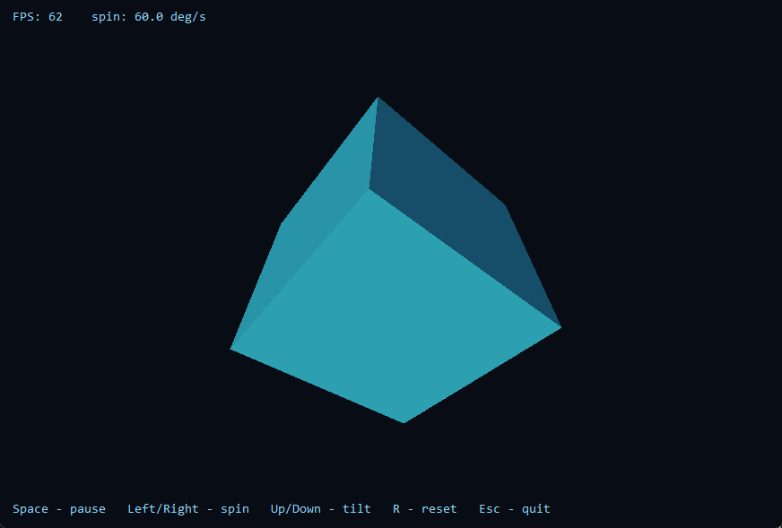

# cube3d

Крутящийся куб на чистом x64 ассемблере. Win32 + GDI, без CRT и без C-рантайма:
всё, что делает программа, видно в одном .asm файле.



## Откуда взялось

Хотелось руками потрогать то, что на C++ прячет компилятор: как программа вообще
попадает в окно, кто вызывает WndProc, что такое соглашение вызова x64 и почему
стек надо выравнивать перед каждым `call`. Ну и куб — потому что его видно, в
отличие от `mov rax, rax`.

Побочный эффект: exe на 8 КБ, 60 FPS, ни одной подключённой библиотеки кроме
kernel32/user32/gdi32.

## Как собрать

Нужен [flat assembler](https://flatassembler.net) (я собирал на 1.73.35).
Кладёшь `FASM.EXE` в папку `tools` и запускаешь `build.bat`. Или вручную:

```
tools\FASM.EXE cube3d.asm
```

Получается `cube3d.exe`. Папку `INCLUDE` я положил в репозиторий, потому что fasm
ищет заголовки (`win64a.inc`) рядом с исходником и без неё не собирается.

## Управление

| клавиша | что делает |
|---|---|
| Space | пауза |
| ← / → | скорость вращения (±5 °/с) |
| ↑ / ↓ | амплитуда наклона |
| R | сброс настроек |
| Esc | выход |

Размер окна можно менять, картинка пересчитывается под клиентскую область.

## Что внутри

* окно целиком на Win32: `RegisterClassEx`, `CreateWindowEx`, цикл
  `GetMessage`/`TranslateMessage`/`DispatchMessage`, своя `WindowProc`;
* двойная буферизация: рисуем в `CreateCompatibleBitmap`, потом `BitBlt` в окно;
* поворот точки — SSE2 (`mulsd`/`addsd` по скалярным double), синусы и косинусы —
  x87 (`fsin`/`fcos`), проекция — обычное деление на `z + 4`;
* грани рисуются алгоритмом художника: сортируем по глубине и рисуем от дальних
  к ближним, поэтому невидимые грани не могут «протечь» сквозь видимые;
* свет плоский: `intensity = 0.15 + 0.85 * max(0, n·L)`, где `L` — направление
  на источник. Цвета — палитра из 32 кистей, создаётся один раз при старте;
* анимация считается по реальному времени (`GetTickCount64`), а не по тикам
  таймера, поэтому скорость не плывёт, когда Windows реже зовёт `WM_TIMER`;
* FPS и форматирование чисел (`int64 -> десятичная строка`) свои, libc нет.

## Грабли, на которые я наступил

* **Мерцало.** Сначала рисовал прямо в окно и заливал фон в `WM_ERASEBKGND`.
  Пока не завёл back buffer и не начал возвращать 1 из `WM_ERASEBKGND` — не отпускало.
* **`AdjustWindowRectExA` не существует.** У этой функции нет A/W варианта, есть
  только `AdjustWindowRectEx`. Программа падала с «Entry Point Not Found» ещё до
  создания окна, и я довольно долго искал, почему. Помог скрипт, который парсит
  таблицу импорта и дёргает `GetProcAddress` по каждой функции.
* **Упало после добавления перьев.** После `SelectObject` в `rax` возвращается
  *старый* объект, а я по этому значению индексировал массив кистей. Обидный
  `0xc0000005`.
* **Тени на невидимых гранях.** Сортировка по глубине была перевёрнута: дальние
  (их не видно) рисовались поверх ближних. Выглядело как тёмные полосы там, где
  их быть не может. Правится одним `jbe` -> `jae`, но искать это было весело.

## Что хочу докрутить

- [ ] z-buffer и загрузка чего-нибудь посложнее куба (`.obj` или `.ply`);
- [ ] затенение по Гуро и спекуляр, а не плоское;
- [ ] вращение мышью;
- [ ] перейти на Direct2D, GDI всё-таки медленный на каждый кадр.

## Лицензия

Код учебный, делай что хочешь.
